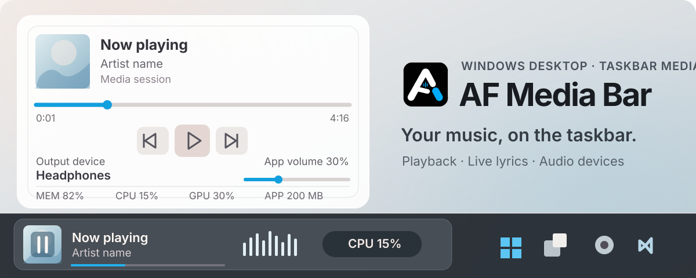

  

  
  
  
  
  
  
  
  
   
  <a href="README.md">简体中文</a> · English · <a href="README.vi-VN.md">Tiếng Việt</a>
   
  <a href="#download-and-run">Download</a> · <a href="#live-demo">Live demo</a> · <a href="https://github.com/Fervent-Tempo/AF-Media-Bar/issues/new?template=bug_report.yml">Report a bug</a> · <a href="https://github.com/Fervent-Tempo/AF-Media-Bar/issues/new?template=feature_request.yml">Request a feature</a> · <a href="docs/localization.md">Help translate</a> · <a href="https://github.com/Fervent-Tempo/AF-Media-Bar/discussions">Discussions and help</a>

AF Media Bar is a media controller for the Windows 10/11 taskbar. It reads what's playing from the system media session and makes media information, lyrics, playback controls, and device switching easier to see and use on your desktop.

## Live demo

  

[Watch the introduction video on Bilibili](https://www.bilibili.com/video/BV17yhh6aEgK)

## Download and run

Open [GitHub Releases](https://github.com/Fervent-Tempo/AF-Media-Bar/releases) and choose a package:

1. **Installer (recommended):** Download `AFMediaBar-Setup-vX.Y.Z-win-x64.exe` and follow the installation wizard.
2. **Portable:** Download `AFMediaBar-vX.Y.Z-win-x64.zip`, extract it to a writable folder, and run `AFMediaBar.exe`.

**Requirements:** Windows 10 1809 or later, x64, with Microsoft Edge WebView2 Runtime. Install the Evergreen Runtime if it is missing. Release packages include the .NET runtime.

## Updating and uninstalling

- **Updates:** The app notifies you when a new version is available. Check for updates on the Application page. Installed builds can download and install updates in the app; portable builds require manual file replacement.
- **Settings:** Stored in `%LOCALAPPDATA%\AFMediaBar\settings.json`. Open the settings folder from the Application page.
- **Uninstall:** Remove installed builds through Windows Installed apps or the Start menu. For portable builds, delete the program folder. To clear settings and cache, also delete `%LOCALAPPDATA%\AFMediaBar` manually.

## Privacy and security

- No telemetry, ads, or account system. Media controls and volume operations run locally.
- Update checks and online lyric searches use the internet. Lyric searches use track and artist information; lyric sources can be disabled in Settings.
- The app runs with the current user's rights. Report security issues privately as described in [SECURITY.md](SECURITY.md).

## Star history

<a href="https://www.star-history.com/?repos=Fervent-Tempo%2FAF-Media-Bar&amp;type=date&amp;legend=top-left">
  <picture>
    <source media="(prefers-color-scheme: dark)" srcset="https://api.star-history.com/chart?repos=Fervent-Tempo/AF-Media-Bar&amp;type=date&amp;theme=dark&amp;legend=top-left">
    <source media="(prefers-color-scheme: light)" srcset="https://api.star-history.com/chart?repos=Fervent-Tempo/AF-Media-Bar&amp;type=date&amp;legend=top-left">
    
  </picture>
</a>

### Project activity

## Project Structure

Application source is in `src/`, tests in `tests/`, and development tools in `tools/`. See the [architecture document](docs/architecture.md#仓库目录) for the directory overview and responsibilities, and the [contribution guide](CONTRIBUTING.md#development-and-validation) for build and test instructions.

## Contributing

Read the [contribution guide](CONTRIBUTING.md) before contributing, and see the [architecture document](docs/architecture.md) for architectural boundaries.

Bug reports should include your Windows version, app version, player, and reproduction steps. See [CHANGELOG.en-US.md](CHANGELOG.en-US.md) for version history.

## Localization and translation

The interface currently supports **简体中文, 繁體中文, English, and Tiếng Việt**. Choose a language on the Application page. The README is available in Chinese, English, and Vietnamese.

Translation contributions in every language are welcome, including new languages and improvements to existing wording. See the [translation contribution guide](docs/localization.md#translation-guide). Use [translation feedback](https://github.com/Fervent-Tempo/AF-Media-Bar/issues/new?template=localization.yml) to report incorrect, missing, or clipped text, or to contribute a new language.

## Acknowledgements

### Contributors

Thank you to all the developers who have contributed to AF Media Bar.

### Open-source projects

Thanks to the following open-source projects:

- [FluentFlyout](https://github.com/unchihugo/FluentFlyout): A simple, modern Windows volume flyout.
- [Lyricify-Lyrics-Helper](https://github.com/WXRIW/Lyricify-Lyrics-Helper): A Lyricify lyrics library for parsing, generating, searching, decrypting, and refining lyrics.
- [TaskbarLyrics](https://github.com/ANYNC/TaskbarLyrics): A Windows taskbar lyrics tool.
- [NAudio](https://github.com/naudio/NAudio): Windows audio capture and processing.
- [WPF UI](https://github.com/lepoco/wpfui): Fluent WPF controls.

## Sponsor

If AF Media Bar helps you, a Star is appreciated ❤️

Buy me a coffee. **Sponsorships above 10 CNY can join the sponsor list — please leave your ID in the payment note.**

| WeChat | Alipay |
| :---: | :---: |
|  |  |

