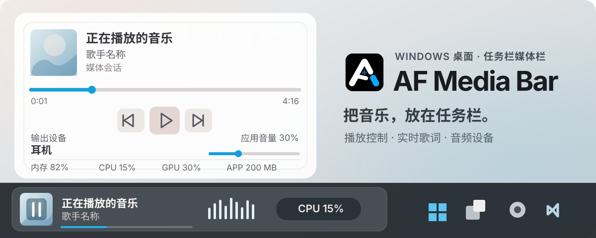

  

  
  
  
  
  
  
  
  
   
  简体中文 · <a href="README.en-US.md">English</a> · <a href="README.vi-VN.md">Tiếng Việt</a>
   
  <a href="#下载安装">下载运行</a> · <a href="#运行演示">运行演示</a> · <a href="https://github.com/Fervent-Tempo/AF-Media-Bar/issues/new?template=bug_report.yml">报告问题</a> · <a href="https://github.com/Fervent-Tempo/AF-Media-Bar/issues/new?template=feature_request.yml">功能建议</a> · <a href="docs/localization.md">参与翻译</a> · <a href="https://github.com/Fervent-Tempo/AF-Media-Bar/discussions">讨论与求助</a>

AF Media Bar 是一款 Windows 10/11 任务栏媒体控制器。它从系统媒体会话读取正在播放的内容，让媒体信息、歌词、播放控制和设备切换在桌面更直观易用。

## 运行演示

  

[观看 Bilibili 介绍视频](https://www.bilibili.com/video/BV17yhh6aEgK)

## 下载安装

前往 [GitHub Releases](https://github.com/Fervent-Tempo/AF-Media-Bar/releases)，选择一种方式：

1. **安装程序（推荐）：** 下载 `AFMediaBar-Setup-vX.Y.Z-win-x64.exe`，按向导安装。
2. **便携版：** 下载 `AFMediaBar-vX.Y.Z-win-x64.zip`，解压到可写目录，运行 `AFMediaBar.exe`。

**系统要求：** Windows 10 1809 或更新的 x64 系统，需要 Microsoft Edge WebView2 Runtime；缺失时先安装 Evergreen Runtime。发布包自带 .NET 运行时。

## 更新与卸载

- **更新：** 发现新版本时会提示，可在「应用」页检查更新。安装版支持程序内下载与安装；便携版需手动替换程序文件。
- **设置：** 保存在 `%LOCALAPPDATA%\AFMediaBar\settings.json`，可从「应用」页打开设置文件夹。
- **卸载：** 安装版通过 Windows“已安装的应用”或开始菜单卸载；便携版直接删除程序目录。若要清除设置与缓存，再手动删除 `%LOCALAPPDATA%\AFMediaBar`。

## 隐私与安全

- 不含遥测、广告或账号系统；媒体控制与音量操作在本机处理。
- 更新检查与在线歌词检索会联网；歌词检索使用曲名、歌手等信息，可在设置中关闭歌词来源。
- 程序以当前用户权限运行。安全问题请按 [SECURITY.md](SECURITY.md) 私下报告。

## Star 历史

<a href="https://www.star-history.com/?repos=Fervent-Tempo%2FAF-Media-Bar&amp;type=date&amp;legend=top-left">
  <picture>
    <source media="(prefers-color-scheme: dark)" srcset="https://api.star-history.com/chart?repos=Fervent-Tempo/AF-Media-Bar&amp;type=date&amp;theme=dark&amp;legend=top-left">
    <source media="(prefers-color-scheme: light)" srcset="https://api.star-history.com/chart?repos=Fervent-Tempo/AF-Media-Bar&amp;type=date&amp;legend=top-left">
    
  </picture>
</a>

### 项目活动

## 项目结构

应用源码位于 `src/`，测试位于 `tests/`，开发工具位于 `tools/`。完整目录与职责划分见 [架构文档](docs/architecture.md#仓库目录)，构建与测试方法见 [贡献指南](CONTRIBUTING.md#开发与验证)。

## 参与贡献

参与贡献前请阅读 [贡献指南](CONTRIBUTING.md)，架构边界见 [架构文档](docs/architecture.md)。

报告问题时请附 Windows 版本、程序版本、播放器与复现步骤。版本记录见 [CHANGELOG.md](CHANGELOG.md)。

## 本地化与翻译

界面目前支持 **简体中文、繁體中文、English 和 Tiếng Việt**，可在「应用」页切换语言。README 提供中文、英文和越南文版本。

欢迎所有语言的翻译贡献，包括新增语言和修正已有译文，参与方式见 [翻译贡献指南](docs/localization.md)。发现错译、缺失或文字显示问题，或希望贡献新的语言，请提交 [翻译反馈](https://github.com/Fervent-Tempo/AF-Media-Bar/issues/new?template=localization.yml)。

## 致谢

### 贡献者

感谢所有参与贡献的开发者。

### 开源项目

感谢以下开源项目：

- [FluentFlyout](https://github.com/unchihugo/FluentFlyout)：简单、现代的 Windows 音量控制弹窗软件。
- [Lyricify-Lyrics-Helper](https://github.com/WXRIW/Lyricify-Lyrics-Helper)：Lyricify 歌词库，提供歌词解析、生成、搜索、解密和优化处理。
- [TaskbarLyrics](https://github.com/ANYNC/TaskbarLyrics)：Windows 任务栏歌词工具。
- [NAudio](https://github.com/naudio/NAudio)：Windows 音频采集与处理。
- [WPF UI](https://github.com/lepoco/wpfui)：Fluent 风格的 WPF 控件。

## 赞助

如果 AF Media Bar 对你有帮助，可以给项目一个 Star❤️。

请作者喝杯咖啡。**大于 10 元的赞助可以进入赞助者名单，请在备注中留下 id。**

| 微信 | 支付宝 |
| :---: | :---: |
|  |  |

