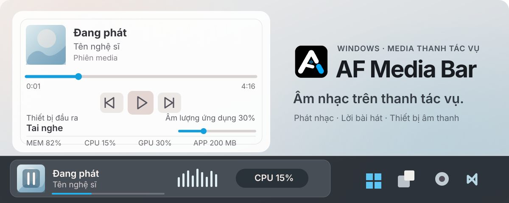
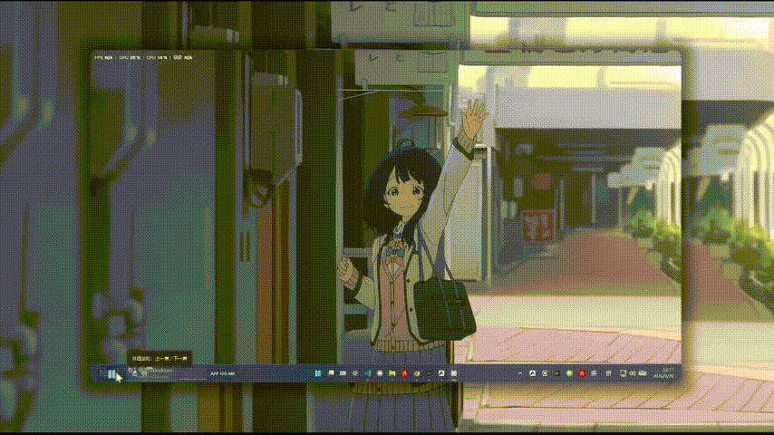

  

  
  
  
  
  
  
  
  
   
  <a href="README.md">简体中文</a> · <a href="README.en-US.md">English</a> · Tiếng Việt
   
  <a href="#tải-về-và-khởi-chạy">Tải về</a> · <a href="#xem-trước-trực-tiếp">Xem trước</a> · <a href="https://github.com/Fervent-Tempo/AF-Media-Bar/issues/new?template=bug_report.yml">Báo cáo lỗi</a> · <a href="https://github.com/Fervent-Tempo/AF-Media-Bar/issues/new?template=feature_request.yml">Đề xuất tính năng</a> · <a href="docs/localization.md">Đóng góp bản dịch</a> · <a href="https://github.com/Fervent-Tempo/AF-Media-Bar/discussions">Thảo luận và trợ giúp</a>

AF Media Bar là bộ điều khiển media trên thanh tác vụ Windows 10/11. Ứng dụng đọc nội dung đang phát từ phiên media của hệ thống, giúp thông tin media, lời bài hát, điều khiển phát nhạc và chuyển thiết bị trở nên trực quan, dễ sử dụng hơn trên desktop.

## Xem trước trực tiếp

  

[Xem video giới thiệu trên Bilibili](https://www.bilibili.com/video/BV17yhh6aEgK)

## Tải về và khởi chạy

Truy cập [GitHub Releases](https://github.com/Fervent-Tempo/AF-Media-Bar/releases) và chọn một gói:

1. **Bộ cài đặt (khuyên dùng):** Tải `AFMediaBar-Setup-vX.Y.Z-win-x64.exe` và làm theo hướng dẫn cài đặt.
2. **Bản portable:** Tải `AFMediaBar-vX.Y.Z-win-x64.zip`, giải nén vào thư mục có quyền ghi và chạy `AFMediaBar.exe`.

**Yêu cầu hệ thống:** Windows 10 1809 trở lên, x64, cùng Microsoft Edge WebView2 Runtime. Nếu thiếu, hãy cài Evergreen Runtime. Các gói phát hành đã tích hợp .NET runtime.

## Cập nhật và gỡ cài đặt

- **Cập nhật:** Ứng dụng thông báo khi có phiên bản mới; bạn có thể kiểm tra trong trang Ứng dụng. Bản cài đặt hỗ trợ tải và cài cập nhật trong ứng dụng; bản portable cần thay thế tệp thủ công.
- **Cài đặt:** Lưu tại `%LOCALAPPDATA%\AFMediaBar\settings.json`; có thể mở thư mục cài đặt từ trang Ứng dụng.
- **Gỡ cài đặt:** Gỡ bản cài đặt qua mục Ứng dụng đã cài đặt của Windows hoặc menu Start. Với bản portable, xóa thư mục chương trình. Để xóa cả cài đặt và bộ nhớ đệm, xóa thêm `%LOCALAPPDATA%\AFMediaBar`.

## Quyền riêng tư và bảo mật

- Không có telemetry, quảng cáo hay tài khoản. Điều khiển media và âm lượng được xử lý trên máy.
- Kiểm tra cập nhật và tìm lời bài hát trực tuyến sử dụng mạng. Tìm lời sử dụng tên bài hát và nghệ sĩ; có thể tắt các nguồn lời trong Cài đặt.
- Ứng dụng chạy với quyền của người dùng hiện tại. Báo cáo vấn đề bảo mật riêng tư theo [SECURITY.md](SECURITY.md).

## Lịch sử Star

<a href="https://www.star-history.com/?repos=Fervent-Tempo%2FAF-Media-Bar&amp;type=date&amp;legend=top-left">
  <picture>
    <source media="(prefers-color-scheme: dark)" srcset="https://api.star-history.com/chart?repos=Fervent-Tempo/AF-Media-Bar&amp;type=date&amp;theme=dark&amp;legend=top-left">
    <source media="(prefers-color-scheme: light)" srcset="https://api.star-history.com/chart?repos=Fervent-Tempo/AF-Media-Bar&amp;type=date&amp;legend=top-left">
    
  </picture>
</a>

### Hoạt động dự án

## Cấu trúc dự án

Mã nguồn ứng dụng nằm trong `src/`, kiểm thử trong `tests/` và công cụ phát triển trong `tools/`. Xem [Tài liệu kiến trúc](docs/architecture.md#仓库目录) để biết cấu trúc thư mục và trách nhiệm, và [Hướng dẫn đóng góp](CONTRIBUTING.md#development-and-validation) để biết cách build và kiểm thử.

## Đóng góp

Đọc [Hướng dẫn đóng góp](CONTRIBUTING.md) trước khi đóng góp; xem [Tài liệu kiến trúc](docs/architecture.md) để biết ranh giới kiến trúc.

Báo cáo lỗi nên kèm phiên bản Windows, phiên bản ứng dụng, trình phát và các bước tái hiện. Xem [CHANGELOG.en-US.md](CHANGELOG.en-US.md) để biết lịch sử phiên bản.

## Bản địa hóa và dịch thuật

Giao diện hiện hỗ trợ **简体中文, 繁體中文, English và Tiếng Việt**. Chọn ngôn ngữ trong trang Ứng dụng. README có phiên bản tiếng Trung, tiếng Anh và tiếng Việt.

Chúng tôi hoan nghênh đóng góp bản dịch ở mọi ngôn ngữ, bao gồm ngôn ngữ mới và cải thiện bản dịch hiện có. Xem [Hướng dẫn đóng góp bản dịch](docs/localization.md#translation-guide). Dùng [Phản hồi bản dịch](https://github.com/Fervent-Tempo/AF-Media-Bar/issues/new?template=localization.yml) để báo cáo bản dịch sai, thiếu, chữ bị cắt hoặc đóng góp ngôn ngữ mới.

## Lời cảm ơn

### Người đóng góp

Cảm ơn tất cả các nhà phát triển đã đóng góp cho AF Media Bar.

### Dự án mã nguồn mở

Cảm ơn các dự án mã nguồn mở sau:

- [FluentFlyout](https://github.com/unchihugo/FluentFlyout): Bảng điều khiển âm lượng Windows đơn giản và hiện đại.
- [Lyricify-Lyrics-Helper](https://github.com/WXRIW/Lyricify-Lyrics-Helper): Thư viện lời bài hát Lyricify để phân tích, tạo, tìm kiếm, giải mã và xử lý lời.
- [TaskbarLyrics](https://github.com/ANYNC/TaskbarLyrics): Công cụ lời bài hát trên thanh tác vụ Windows.
- [NAudio](https://github.com/naudio/NAudio): Thu và xử lý âm thanh Windows.
- [WPF UI](https://github.com/lepoco/wpfui): Điều khiển WPF theo phong cách Fluent.

## Tài trợ

Nếu AF Media Bar hữu ích với bạn, hãy tặng dự án một Star ❤️

Ủng hộ tác giả một tách cà phê. **Khoản tài trợ trên 10 CNY có thể được ghi vào danh sách nhà tài trợ; vui lòng để lại ID trong ghi chú thanh toán.**

| WeChat | Alipay |
| :---: | :---: |
|  |  |

